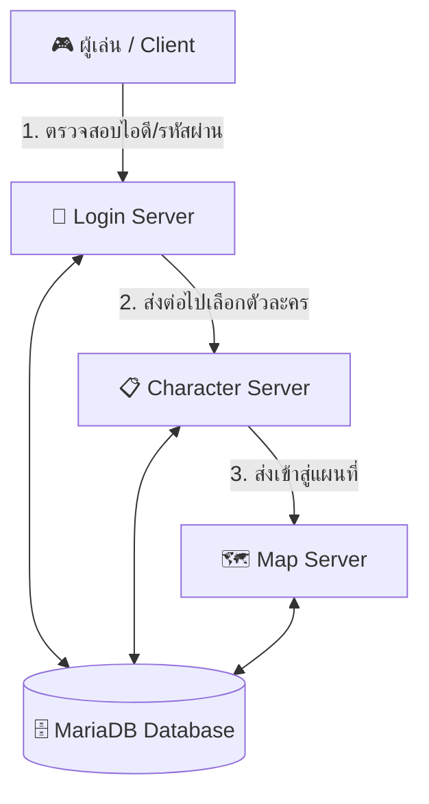

# 📖 ตำราเรียนรู้และคู่มือสร้างเซิร์ฟเวอร์ Ragnarok Online ฉบับครูสอนเข้าใจง่าย (FurRo)

ยินดีต้อนรับสู่คู่มือการเรียนรู้ระบบเซิร์ฟเวอร์ Ragnarok Online ครับ! เอกสารฉบับนี้เขียนขึ้นเพื่อให้คุณไม่เพียงแค่ "ทำตามได้" แต่จะช่วยให้คุณ "เข้าใจถึงแก่นแท้" ว่าแต่ละโปรแกรม แต่ละไฟล์ ทำหน้าที่อะไร และ **ทำไมเราถึงต้องทำแบบนี้**

---

## 🏛️ บทที่ 1: สถาปัตยกรรมของ Ragnarok Online (ทำความเข้าใจภาพรวม)

หลายคนอาจสงสัยว่า *ทำไมเวลาเปิดเซิร์ฟ RO ถึงมีหน้าต่างดำๆ (Console) เด้งขึ้นมาตั้งหลายตัว? ทำไมไม่รวมเป็นไฟล์ `.exe` เดียวไปเลย?*

คำตอบคือ **RO ถูกออกแบบด้วยสถาปัตยกรรมแบบแยกส่วน (Modular Architecture)** โดยแบ่งงานกันทำ 3 ฝ่าย เพื่อรองรับผู้เล่นจำนวนมากและไม่ให้เซิร์ฟเวอร์ค้าง:



1. **Login Server (`login-server.exe` - แผนกต้อนรับหน้าประตู):**
   - **ทำไมต้องมี?:** ทำหน้าที่ตรวจสอบ Username และ Password ตรวจดูว่าไอดีนี้โดนแบนไหม ถูกต้องไหม เมื่อตรวจผ่านจะส่งต่อไปที่ Char Server
2. **Character Server (`char-server.exe` - แผนกทะเบียนประวัติ):**
   - **ทำไมต้องมี?:** ทำหน้าที่โหลดรายชื่อตัวละคร ทรงผม เลเวล ช่องเก็บของ และสร้างตัวละครใหม่ พอเรากด "เข้าเกม" มันจะส่งตัวละครเราเข้าสู่แผนที่
3. **Map Server (`map-server.exe` - สนามเด็กเล่น / สมองหลักของเกม):**
   - **ทำไมต้องมี?:** เป็นตัวที่ทำงานหนักที่สุด ควบคุมการเคลื่อนไหว สกิล ดาเมจ การเกิดของมอนสเตอร์ เควสต์ และ NPC ทั้งหมดในโลก RO
4. **Database (MariaDB - ตู้เซฟเก็บความจำ):**
   - **ทำไมต้องมี?:** ถ้าไม่มีตู้เซฟ เวลาปิดเซิร์ฟเวอร์ เลเวลและของในตัวผู้เล่นก็จะหายหมด MariaDB ทำหน้าที่เก็บทุกอย่างลงดิสก์อย่างถาวร

---

## 🛠️ บทที่ 2: สิ่งที่เราทำไปแล้ว และ "ทำไปเพื่ออะไร?"

| สิ่งที่ได้ทำไป | ทำไปเพื่ออะไร? (The "Why") |
| :--- | :--- |
| **ใช้ rAthena Renewal** | เพื่อให้ได้ระบบเกมยุคใหม่ รองรับอาชีพ Class 3, Class 4 และแมวดอรัม (Doram) พร้อมสูตรคำนวณสเตตัสและมอนสเตอร์ใหม่ล่าสุด |
| **ตั้ง PACKETVER เป็น `20211103`** | เซิร์ฟเวอร์กับตัวเกม (Client) คุยกันด้วยภาษา "Packet" ถ้าเลขเวอร์ชันไม่ตรงกัน ตัวเกมจะเด้งหลุดหรือขึ้น "Connecting to server" ค้าง เราเลือกเลขนี้เพราะเป็นเวอร์ชันที่เสถียรที่สุดสำหรับ Renewal |
| **ทำ MariaDB แบบ Portable** | ปกติถ้าลง MySQL ตัวเต็ม มันจะฝัง Service ลงใน Windows และสร้างไฟล์ใน `C:\Program Files` ทำให้เวลาย้ายโฟลเดอร์ไปเครื่องอื่นจะพังทันที เราเลยทำเป็น Portable และใช้คำสั่ง `%~dp0` เพื่อให้**วางไว้ที่ไดรฟ์ไหน เครื่องไหน ก็เปิดติด 100%** |
| **ใช้ Build Tools CLI แทน Visual Studio** | ประหยัดพื้นที่ดิสก์ไปกว่า **15–20 GB**! แทนที่จะลงโปรแกรมเขียนโค้ดยักษ์ใหญ่ เราโหลดเฉพาะ "คอมไพเลอร์หลังบ้าน" มาบิลด์โค้ดอย่างเดียว |
| **ทำสคริปต์ One-Click (.bat)** | เพื่อความสะดวกสูงสุดในการใช้งาน ไม่ต้องพิมพ์คำสั่ง CMD ยาวๆ ทุกครั้ง |

---

## 🎯 บทที่ 3: สิ่งที่ต้องทำต่อไป (ฝั่งตัวเกม Client)

ตอนนี้ฝั่ง **หลังบ้าน (Server + Database)** พร้อมแล้ว สิ่งที่ยังขาดคือ **หน้าบ้าน (Client)** ซึ่งผู้เล่นใช้เปิดเข้าเกม โดยมีหัวใจหลัก 3 อย่างดังนี้:

### 1. `data.grf` คืออะไร?
- **คำอธิบาย:** เป็นไฟล์คลังข้อมูลขนาดใหญ่ที่รวม รูปภาพมอนสเตอร์, เสื้อผ้าตัวละคร, แผนที่, โมเดล 3D และเสียงเอฟเฟกต์ทั้งหมดของเกม RO
- **ทำไมต้องมี?:** ถ้าไม่มีไฟล์นี้ ตัวเปิดเกมจะไม่รู้ว่ามอนสเตอร์หน้าตายังไง แมพหน้าตายังไง และจะ Error เด้งหลุดทันที

### 2. Client Exe (Ragexe) และการ "Diff / Patch"
- **คำอธิบาย:** ปกติไฟล์ `.exe` ดั้งเดิมจาก Gravity เกาหลี จะล็อคให้เชื่อมต่อไปยังเซิร์ฟเวอร์ทางการของเขาเท่านั้น และมีระบบ GameGuard ดักไว้
- **ทำไมต้อง Patch (Diff)?:** เราต้องใช้โปรแกรมชื่อ **NEMO** หรือ **WARP** มาปลดล็อก (Diff) ตัว `.exe` เพื่อ:
  - สั่งให้ชี้ IP มาที่เครื่องเรา (`127.0.0.1`)
  - ปิด GameGuard เพื่อไม่ให้บล็อก
  - อนุญาตให้พิมพ์และอ่านภาษาไทยได้
  - ให้ตัวเกมอ่านไฟล์ในโฟลเดอร์ `data/` ภายนอกก่อนอ่านจากไฟล์ grf

### 3. `clientinfo.xml` คืออะไร?
- **คำอธิบาย:** เป็นไฟล์ Text สั้นๆ ที่บอก Client ว่า:
  - ชื่อเซิร์ฟเวอร์คืออะไร (เช่น `FurRo`)
  - ให้เชื่อมต่อไปที่ IP อะไร (`127.0.0.1`)
  - พอร์ตอะไร (`6900` ซึ่งเป็นพอร์ตมาตรฐานของ Login Server)
  - และเวอร์ชัน Packet คือเท่าไร (`20211103`)

---

## 🚀 บทที่ 4: ลำดับขั้นตอนการเปิดใช้งานจริง (Step-by-Step)

เมื่อใดก็ตามที่คุณหรือเพื่อนของคุณต้องการเปิดเซิร์ฟเวอร์ ให้ทำตามลำดับนี้เสมอ:

```
[ขั้นตอนที่ 1]              [ขั้นตอนที่ 2]              [ขั้นตอนที่ 3]
เปิดฐานข้อมูล              คอมไพล์โค้ด (ครั้งแรก)         เปิดเซิร์ฟเวอร์เกม
Database/start_db.bat  -->  Server/build_server.bat  -->  Server/start_server.bat
```

1. **ขั้นตอนที่ 1 (เปิดฐานข้อมูล):**
   - เข้าโฟลเดอร์ `Database/` แล้วดับเบิลคลิก `start_db.bat`
   - รอจนขึ้นข้อความว่า `MariaDB is RUNNING successfully on port 3306!`
2. **ขั้นตอนที่ 2 (คอมไพล์โค้ด - ทำเฉพาะครั้งแรกหรือเมื่อมีการแก้โค้ด C++):**
   - เข้าโฟลเดอร์ `Server/` ดับเบิลคลิก `build_server.bat`
   - รอจนขึ้น `SUCCESS: rAthena compiled successfully!` (จะได้ไฟล์ `.exe` ครบทุกตัว)
3. **ขั้นตอนที่ 3 (เปิดเซิร์ฟเวอร์เกม):**
   - เข้าโฟลเดอร์ `Server/` ดับเบิลคลิก `start_server.bat`
   - หน้าต่างดำๆ 3 ตัว (Login, Char, Map) จะเปิดขึ้นมาทำงานร่วมกัน
4. **ขั้นตอนที่ 4 (เข้าเกม):**
   - เปิดตัวเกมจากโฟลเดอร์ `Client/` แล้วล็อกอินเข้าเล่นได้เลย!

---

## 💡 บทที่ 5: ปัญหาที่พบบ่อยและวิธีแก้ไข (Troubleshooting)

### อาการที่ 1: ตัวเกมค้างที่หน้า "Connecting to server..."
- **สาเหตุ:** Client หา Login Server ไม่เจอ
- **วิธีแก้:** 
  1. ตรวจดูว่ารัน `start_server.bat` หรือยัง?
  2. ตรวจสอบไฟล์ `clientinfo.xml` ในโฟลเดอร์ Client ว่าใส่ IP เป็น `127.0.0.1` และ Port `6900` หรือไม่

### อาการที่ 2: Map Server ขึ้นตัวหนังสือสีแดง "Can't connect to MySQL"
- **สาเหตุ:** ลืมเปิดฐานข้อมูลก่อนรันเซิร์ฟเวอร์
- **วิธีแก้:** ให้ปิดหน้าต่างเซิร์ฟเวอร์ แล้วไปดับเบิลคลิก `Database/start_db.bat` ให้เรียบร้อยก่อน แล้วค่อยเปิดเซิร์ฟเวอร์ใหม่

### อาการที่ 3: ตัวเกมเด้ง Gravity Error หลุดออกมา
- **สาเหตุ:** ขาดไฟล์กราฟิก (Sprite / Resource) เช่น ไอเทมหรือมอนสเตอร์ตัวนั้นไม่มีรูปใน `data.grf`
- **วิธีแก้:** นำ `data.grf` ตัวเต็มที่สมบูรณ์มาใส่ในโฟลเดอร์ Client

---

## 👑 บทที่ 6: คำสั่ง Game Master (GM) พื้นฐานสำหรับทดสอบ
เมื่อเข้าเกมด้วยตัวละครที่มีสิทธิ์ GM (หรือตั้งค่าในเซิร์ฟเวอร์ให้ทดสอบได้) สามารถพิมพ์คำสั่งเหล่านี้ในช่องแชท:

- `@blvl 99` : ปรับเลเวลตัวละครเป็น 99 (หรือเลเวลที่ต้องการ)
- `@jlvl 70` : ปรับเลเวลจ๊อบ
- `@item 607 10` : เสกไอเทม (รหัส 607 คือ Yggdrasil Berry จำนวน 10 ชิ้น)
- `@zeny 10000000` : เสกเงิน Zeny
- `@go 0` : วาร์ปไปเมืองหลวง Prontera
- `@speed 1` : เพิ่มความเร็วในการเดินสูงสุด
